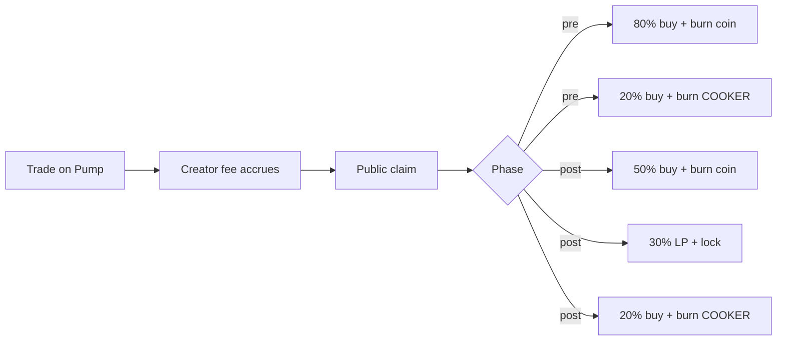

<p align="center">
  
</p>

<p align="center">
  <strong>Creator fees become visible market pressure.</strong><br />
  From the first trade through migration.
</p>

<p align="center">
  <a href="https://usecooker.xyz"></a>
  <a href="https://x.com/usecooker"></a>
  <a href="#fee-splits"></a>
  <a href="#fee-splits"></a>
</p>

<p align="center">
  <code>Trade → Creator fee → Public claim → Buy · Burn · Lock</code>
</p>

---

## What this is

COOKER is a **fee engine for Pump coins on Solana**.

You attach (or launch) a coin so creator fees route to the COOKER treasury. When fees are claimed, the engine spends them on the open market — no private skimming, no invisible wallet dump. Pressure shows up where traders already look: the chart.

| Phase | What happens |
| --- | --- |
| **Pre-migration** | Bonding-curve coin. Fees buy + burn the coin, and buy + burn COOKER. |
| **Post-migration** | Graduated coin. Fees buy + burn the coin, deepen + lock LP, and buy + burn COOKER. |

> Visibility is the product. Pressure nobody can see doesn’t change behavior.

---

## Fee splits

Every claim is **100%** of the creator fee for that coin. The COOKER leg is part of the same split — not a second cut on top.

### Pre-migration

```
claimed SOL
 ├─ 80%  → buy coin on curve  → burn
 └─ 20%  → buy COOKER         → burn
```

| Leg | Share | Effect |
| --- | ---: | --- |
| Coin buyback | **80%** | Market buy, then burn. Prints on the chart. Supply drops. |
| COOKER | **20%** | Market buy of COOKER, then burn. |
| LP | **0%** | Curve phase — no LP yet. |

### Post-migration

```
claimed SOL
 ├─ 50%  → buy coin on pool   → burn
 ├─ 30%  → deposit into LP    → burn LP tokens (lock)
 └─ 20%  → buy COOKER         → burn
```

| Leg | Share | Effect |
| --- | ---: | --- |
| Coin buyback | **50%** | Market buy, then burn. |
| LP deepen | **30%** | Deposit into the pool, burn LP so liquidity cannot be pulled. |
| COOKER | **20%** | Market buy of COOKER, then burn. |



---

## One claim, in code

Pure math. No RPC. No keys. Copy-paste and play with numbers.

```ts
// protocol/splits.ts
export type Phase = "pre-migrate" | "migrated"

export const SPLITS = {
  "pre-migrate": { coinBuyback: 80, lp: 0, cooker: 20 },
  migrated:      { coinBuyback: 50, lp: 30, cooker: 20 },
} as const

/** Split a claimed SOL amount into the three cook legs. */
export function splitClaim(lamports: bigint, phase: Phase) {
  const s = SPLITS[phase]
  const coin = (lamports * BigInt(s.coinBuyback)) / 100n
  const lp   = (lamports * BigInt(s.lp)) / 100n
  const cooker = lamports - coin - lp // remainder absorbs dust
  return { coin, lp, cooker, total: lamports }
}

// 1 SOL claimed, pre-migration → 0.8 / 0 / 0.2
console.log(splitClaim(1_000_000_000n, "pre-migrate"))
```

Run it:

```bash
npx tsx protocol/splits.ts
```

---

## How a coin joins

Two doors. Same destination.

### 1. Launch on COOKER

Launch through [usecooker.xyz/launch](https://usecooker.xyz/launch). Fee routing is set from block zero — first trade already feeds the engine.

### 2. Opt in an existing Pump coin

Point the coin’s creator-fee recipient / share config at the COOKER treasury. No relaunch. Once fees accrue, claims run the active split for that phase.

```
┌─────────────────────────────────────────────────────────┐
│  Fee recipient (treasury)                               │
│  CookXaMAvFhXzAP4gRL43VgSn4e3pFapUki31NSQgu3t           │
└─────────────────────────────────────────────────────────┘
```

Verify a mint is attached (read-only, public RPC):

```bash
npx tsx protocol/check-attach.ts <MINT>
```

```ts
// protocol/check-attach.ts — high-level shape (see file for full script)
import { PublicKey } from "@solana/web3.js"

export const COOKER_TREASURY = new PublicKey(
  "CookXaMAvFhXzAP4gRL43VgSn4e3pFapUki31NSQgu3t"
)

export function describeAttach(opts: {
  cashback: boolean
  holderReward: boolean
  attachedToCooker: boolean
}) {
  if (opts.cashback) return "Cashback coin — fees stay with traders, cannot cook."
  if (opts.holderReward) return "Holder-reward coin — fees pay holders, not a recipient."
  if (opts.attachedToCooker) return "Attached. Claims feed the COOKER split."
  return "Not attached. Point fee shares at the COOKER treasury to opt in."
}
```

---

## Why claims matter

```
private wallet drain     →  invisible, deniable, chart-blind
public claim + market buy →  explorer-visible, chart-visible, supply-changing
```

COOKER is built for the second line. Every cook is meant to be readable: claim tx, buy tx, burn tx. That is the point.

---

## Repo map

This repository is the **public surface** — protocol code and docs you can trust without needing the private app.

```
.
├── README.md                 ← you are here
├── LICENSE
├── docs/
│   ├── PROTOCOL.md           ← splits, phases, definitions
│   ├── SECURITY.md           ← what is public vs private
│   └── FAQ.md
├── protocol/
│   ├── splits.ts             ← fee math
│   ├── check-attach.ts       ← read-only attach check
│   ├── protocol.ts           ← public constants
│   └── package.json          ← optional local run
└── assets/
    ├── cooker-header.png
    └── cooker-logo.png
```

Product UI lives at **[usecooker.xyz](https://usecooker.xyz)**.

| Surface | Link |
| --- | --- |
| Explore | [usecooker.xyz/explore](https://usecooker.xyz/explore) |
| Cooks tape | [usecooker.xyz/cooks](https://usecooker.xyz/cooks) |
| Launch | [usecooker.xyz/launch](https://usecooker.xyz/launch) |
| Fee flow | [usecooker.xyz/flow](https://usecooker.xyz/flow) |
| Docs | [usecooker.xyz/docs](https://usecooker.xyz/docs) |

---

## Constants (public)

```ts
export const PROTOCOL = {
  name: "COOKER",
  handle: "@UseCooker",
  site: "https://usecooker.xyz",
  x: "https://x.com/usecooker",
  /** On-chain fee recipient — safe to publish */
  feeRecipient: "CookXaMAvFhXzAP4gRL43VgSn4e3pFapUki31NSQgu3t",
} as const
```

---

## Security posture

- **Published here:** fee recipient address, split tables, conceptual flow, `protocol/` code.
- **Never published:** private keys, treasury key material, webhook secrets, admin tokens, database credentials, keeper auth.
- `protocol/` talks to **public Solana RPC** only. It cannot claim fees or move funds.

See [docs/SECURITY.md](docs/SECURITY.md).

---

## Status

COOKER is shipping in public. Splits and routing rules above are the protocol contract we build against. On-chain cooks appear on [usecooker.xyz/cooks](https://usecooker.xyz/cooks) as the engine runs.

---

## License

MIT — see [LICENSE](LICENSE).

---

<p align="center">
  <sub>Built for coins that want pressure the chart can see.</sub><br />
  <a href="https://usecooker.xyz">usecooker.xyz</a>
  ·
  <a href="https://x.com/usecooker">@UseCooker</a>
</p>
